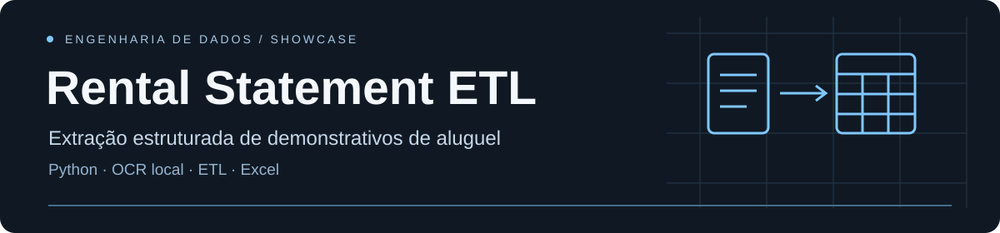
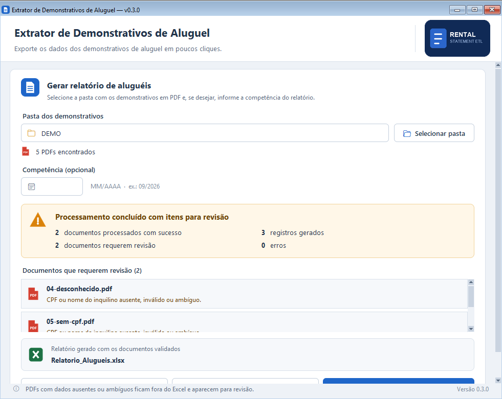
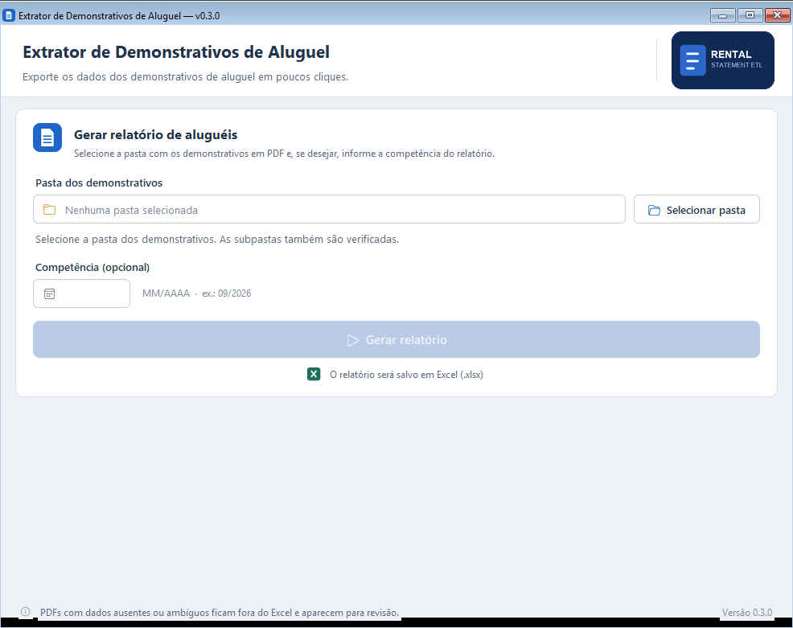
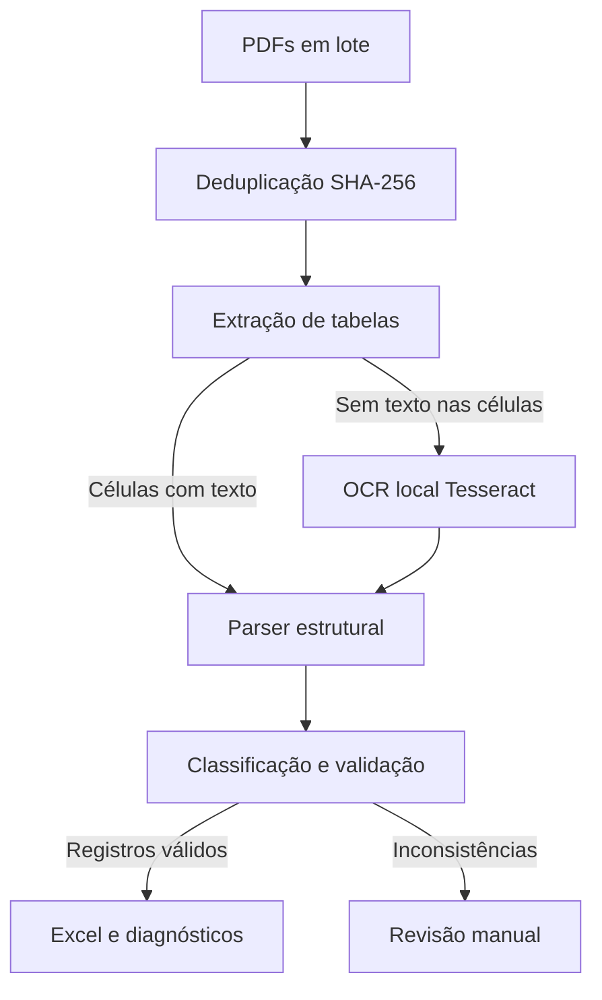

<p align="center"></p>

# Extrator de Demonstrativos de Aluguel

Desenvolvi esta aplicação desktop Windows em Python para transformar demonstrativos de aluguel em registros financeiros estruturados, com extração de PDFs digitais e digitalizados, OCR local, validação, rastreabilidade e exportação para Excel.

| Versão auditada | Testes automatizados | Build Windows |
| --- | --- | --- |
| **0.3.0** | **64/64 aprovados** | **Executável onedir validado** |

Auditoria local de 26/11/2026, na candidata `af9fae8`. Os resultados referem-se a essa revisão; a execução do CI remoto e a distribuição pública do binário são verificações distintas.

## Demonstração



*Captura da janela real do executável 0.3.0, com marca neutra e dados sintéticos.*

<details><summary>Ver demonstração visual (18 segundos)</summary>



Sequência dos quatro estados capturados durante a demonstração, com pausas para leitura; não representa a duração real do processamento.

</details>

[Janela inicial](assets/showcase/screenshots/01-inicio.png) · [Seleção dos PDFs](assets/showcase/screenshots/02-selecao.png) · [Processamento](assets/showcase/screenshots/03-processamento.png)

## O problema

Demonstrativos semiestruturados contêm valores de naturezas distintas. Extrair apenas os números não é suficiente: é necessário associar cada evento à linha e coluna corretas. O sistema automatiza esse trabalho para uma família específica de documentos de uma página e encaminha estruturas ambíguas para revisão.

## Pipeline ETL



O OCR entra quando a extração não encontra texto nas células da tabela. Uma estrutura inválida que contém texto pode seguir diretamente para revisão. O parser utiliza a coluna `Bruto` e o histórico correspondente; não seleciona valores pelo tamanho.

## Resultado de uma execução real

No ensaio com o executável Windows, processei cinco PDFs sintéticos: dois documentos aceitos, três registros, dois itens para revisão e uma cópia binária ignorada.

| Evento | Valor extraído |
| --- | ---: |
| Aluguel — PDF digital | R$ 321,45 |
| Multa contratual — PDF digital | R$ 12,34 |
| Aluguel — OCR | R$ 432,10 |
| **Total demonstrativo** | **R$ 765,89** |

O total é a soma ilustrativa dos registros, não uma linha adicional exportada. Taxa administrativa, condomínio e totais não foram tratados como eventos suportados. A planilha mantém `CPF | NOME | VALOR DO ALUGUEL`, com CPFs como texto e valores monetários numéricos.

## Engenharia e arquitetura

- Processamento isolado por arquivo, com diagnósticos de inconsistências.
- Classificação determinística de `ALUGUEL` e `MULTA_CONTRATUAL`.
- Normalização e validação de CPF, preservando zeros iniciais.
- Aritmética decimal e seleção de valores por estrutura documental.
- Deduplicação conservadora: apenas arquivos com bytes idênticos são descartados.
- Rastreabilidade por PDF e exportação para Excel com diagnóstico separado.
- Interface modular com tema, widgets, recursos, modelo de apresentação, threads e fila de atualização da GUI.

[Arquitetura](docs/showcase/ARQUITETURA.md) · [Pipeline detalhado](docs/showcase/PIPELINE.md) · [Validação e limitações](docs/showcase/VALIDACAO.md)

## Tecnologias

Python 3.12 · Tkinter/ttk · pdfplumber · pdfminer.six · pypdfium2 · Tesseract OCR · Pillow · openpyxl · unittest · PyInstaller · GitHub Actions

## Estrutura do projeto

```text
alugueis_extrator/    núcleo ETL, validação, exportação, GUI e diagnósticos
alugueis_extrator/ui/ tema, widgets e recursos visuais
tests/                testes sintéticos
docs/                 documentação técnica
build.ps1             empacotamento Windows
ExtratorAlugueis.spec configuração PyInstaller
```

## Executar localmente

No Windows, com Python 3.12:

```powershell
py -3.12 -m venv .venv
.\.venv\Scripts\python.exe -m pip install -r requirements-dev.txt
.\.venv\Scripts\python.exe -m unittest discover -s tests -v
.\.venv\Scripts\python.exe run_desktop.py
```

Para executar OCR a partir do código-fonte, providencie uma distribuição compatível do Tesseract e os dados de idioma indicados em [DEVELOPMENT.md](DEVELOPMENT.md). O repositório público não inclui os binários do OCR.

Para gerar o pacote Windows, com as dependências provisionadas:

```powershell
.\build.ps1
```

A distribuição onedir mantém o executável e a pasta `_internal` juntos. Consulte [DEVELOPMENT.md](DEVELOPMENT.md) e [THIRD_PARTY_NOTICES.txt](THIRD_PARTY_NOTICES.txt) para detalhes de execução e dependências.

## Validação, privacidade e escopo

A candidata 0.3.0 passou em 64 testes locais, incluindo 20 novos casos relacionados à interface, integração e DPI simulado. A comparação com a 0.2.4 confirmou os mesmos dados, tipos e formatos de Excel para os cinco PDFs sintéticos. Não repeti a validação histórica em 51 documentos reais nesta auditoria e mantenho esses documentos privados.

O processamento ocorre localmente, sem API externa ou LLM em tempo de execução. O suporte é limitado aos layouts e eventos explicitamente implementados em PDFs de uma página. Desenvolvi a ferramenta para esse conjunto de documentos, não como sistema contábil completo ou extrator universal. Ainda não atribuí uma licença ao projeto.

---

Desenvolvido por [Guilherme Sampaio](https://github.com/gsampaio-dev).
