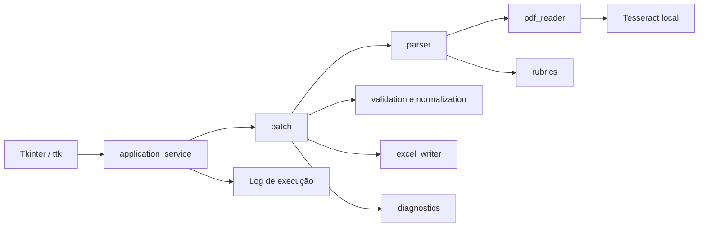

# Arquitetura local

A GUI conta os arquivos e executa o serviço em threads. A thread principal consulta uma fila e atualiza os widgets. O serviço valida a competência opcional e escolhe um nome de saída livre. O núcleo processa os documentos em sequência, acumulando eventos validados por documento. Uma falha de validação impede que parte do demonstrativo entre no relatório.

RentalRecord transporta origem, CPF, nome, categoria, histórico original e valor. BatchReport reúne registros, problemas e avisos. O caminho relativo distingue PDFs com o mesmo nome em subpastas. A planilha entrega os três campos de importação e o JSON conserva o detalhe técnico. A gravação da planilha usa arquivo temporário e substituição no destino. Planilha, JSON e log são arquivos distintos e sua gravação não forma uma transação única.

Python coordena a execução. pdfplumber e pdfminer.six leem o PDF, pypdfium2 e Pillow preparam imagens, Tesseract reconhece texto e openpyxl exporta o Excel. ReportLab gera PDFs de teste. unittest cobre o serviço e o parser. PyInstaller reúne aplicação, bibliotecas e OCR em uma distribuição onedir. A configuração windowed e as opções Windows do subprocesso tratam separadamente a console da GUI e a do OCR.

## Camada desktop da 0.3.0

O módulo gui_presentation transforma o resultado do lote em métricas, linhas de revisão e avisos. O pacote ui concentra tema, recursos locais e widgets. A janela atualiza seus estados a partir da mesma fila de trabalho e do mesmo serviço. O pacote Windows e o pacote Python incluem o PNG neutro.
