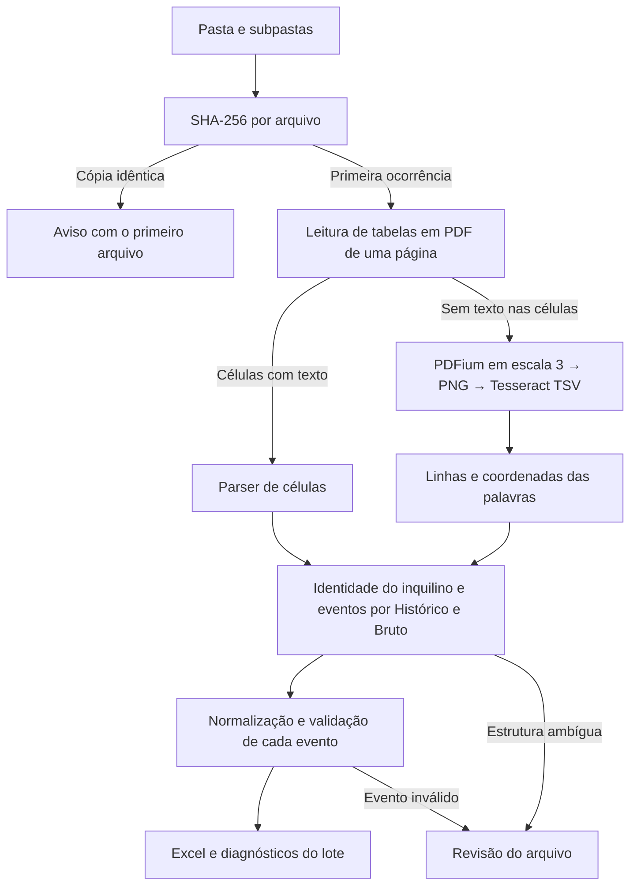

# Do PDF ao registro

O parser busca a identificação INQ. e o CPF no contexto do inquilino. Na extração nativa, normaliza células e trata glifos duplicados. O cabeçalho localiza as colunas relevantes. O classificador admite Aluguel e Multa Contratual com os complementos previstos. Taxa ADM./Aluguel, condomínio, subtotais e pagamentos não geram eventos. Uma rubrica financeira desconhecida em linha analisada pode colocar todo o documento em revisão.

No caminho de imagem, Tesseract usa português e inglês, segmentação 6 e saída TSV. O parser agrupa palavras por linha, verifica a sequência dos seis cabeçalhos e delimita a coluna Bruto pelos centros horizontais das colunas vizinhas. Exige data na região de vencimento e um único candidato monetário na região de Bruto da linha reconhecida.

A normalização mantém onze dígitos do CPF, inclusive zeros iniciais. O nome recebe normalização Unicode NFC, espaços uniformes e maiúsculas. A validação rejeita caracteres ilegíveis, CPFs repetitivos ou com verificadores incorretos. O valor brasileiro é convertido em Decimal. A escrita no XLSX usa célula numérica e formato com duas casas.
